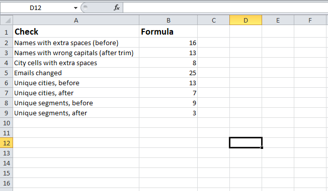
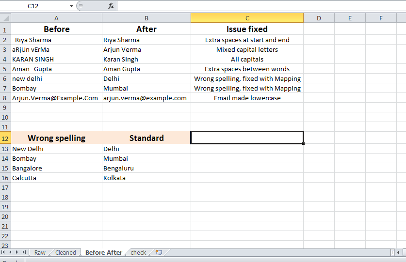

# Text Cleaning Basics (Synthetic Customer Dataset)

## Overview
Cleaned a messy customer dataset (30 rows) using Excel text functions. The data is synthetic
(made-up, not real people) and was created with typical problems: extra spaces, wrong capital
letters and different spellings of the same city.

## Workbook structure
- Raw: the messy data, not changed (the "before")
- Cleaned: the cleaned data, made with formulas
- Before After: examples of what changed
- Checks: formulas that count the problems before and after cleaning

## Cleaning steps
| Column | Formula idea | What it fixes |
|---|---|---|
| Full Name | PROPER(TRIM(name)) | Extra spaces, ALL CAPS, lowercase, mixed capitals |
| City | PROPER(TRIM(city)), then VLOOKUP on the Mapping table | Extra spaces, capitals, wrong spellings |
| Country | PROPER(TRIM(country)) | Extra spaces and capitals |
| Email | LOWER(TRIM(email)) | Extra spaces and capitals |
| Segment | PROPER(TRIM(segment)) | Extra spaces and capitals |

## Results
| Check | Before | After |
|---|---|---|
| Names with extra spaces | 16 | 0 |
| Names with wrong capital letters (after TRIM) | 13 | 0 |
| City cells with extra spaces | 8 | 0 |
| Emails changed (spaces or capitals) | 25 | |
| Unique cities | 13 | 7 |
| Unique segments | 9 | 3 |
| Unique countries | 3 | 1 |

- 29 of the 30 names were changed by the cleaning.
- Two city spellings were fixed with the Mapping table: "new delhi" became Delhi and "Bombay"
  became Mumbai.
- After cleaning, the cities are: Pune 9, Delhi 6, Hyderabad 4, Kolkata 4, Mumbai 4,
  Chennai 2 and Bengaluru 1 (30 in total).

## Limitation
PROPER does not handle every name. For example, it turns "mcdonald" into "Mcdonald", not
"McDonald". This dataset has no such names, but real data may need a manual fix table.

## Tools Used
Microsoft Excel (TRIM, PROPER, LOWER, VLOOKUP, IFERROR, EXACT, SUMPRODUCT, COUNTIF)

## Dataset
Synthetic customer dataset (30 rows) created for this task

## Screenshots

